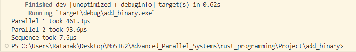
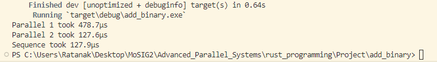
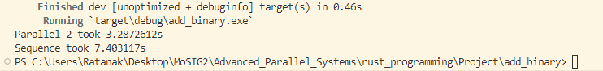

# Parallel Programming Report

## 1. Overview

Binary addition is a fundamental operation often used in computing, and optimizing its performance can be crucial. The Rust program in this repository explores one sequential and two parallel algorithms for binary addition, using the `rayon` library to use several CPU cores.

## 2. How to run

```bash
cargo run --release              # random length between 1 and 10 digits
cargo run --release -- 100000    # two random numbers of 100,000 digits each
cargo test                       # correctness tests
```

`main` checks that every algorithm returns the same sum as the sequential one, and stops with an error if one of them differs.

## 3. Binary Addition Functions

### 3.1 Sequential Binary Addition

- **Function:** `add_binary(a: &str, b: &str) -> String`
- **Description:** Adds two binary numbers digit by digit, starting from the right (least significant digit), and carries a 1 to the next digit when a column adds up to 2 or more.

  - Ex: a = `111`, b = `110`
  - Reversed (read from the right): rev_a = `111`, rev_b = `011`
  - index 1: 1 + 0 = 1, carry 0
  - index 2: 1 + 1 = 0, carry 1
  - index 3: 1 + 1 + 1 = 1, carry 1
  - The last carry becomes the leading digit, so the result is `1101`

- The function reads digits with `as_bytes()[i]`, which takes constant time. (An earlier version used `chars().nth(i)`, which walks the string from the start each time, so the whole loop was O(n²).)

### 3.2 First Parallel Binary Addition

- **Function:** `par_add_binary1(a: &str, b: &str) -> String`
- **Description:** Converts both binary strings to decimal numbers in parallel, adds them, and converts the sum back to binary with the `rayon` library.
- **Limitation:** The numbers are stored in a `u64`, which holds 64 bits. With 64 digits or more, the conversion fails (`from_str_radix` returns an error) or the sum overflows, so this function only accepts numbers with fewer than 64 digits. (This is an integer overflow, not a memory problem.)
- **Why it is slow:** Converting two numbers "in parallel" and adding them is almost no parallel work, so the cost of starting threads is larger than the work itself.

### 3.3 Second Parallel Binary Addition

- **Function:** `par_add_binary(a: &str, b: &str) -> String`
- **Description:** Splits the digits into chunks, one per thread. Each chunk can be added independently, except for one thing: the **carry** coming from the chunk on its right.
- **Solution (carry-select):** every chunk is added **twice in parallel**, once assuming a carry-in of 0 and once assuming a carry-in of 1. Each run also reports its carry-out. Then the carries are chained from the lowest chunk to the highest (only one step per chunk, not per digit), and the matching result of each chunk is kept.
- **Previous problem:** the first version of this function started every chunk with carry 0, so carries between chunks were lost, and it also joined the chunks in the wrong digit order. Random tests showed it was wrong in most cases. The current version is checked against the sequential result and against `u128` addition in `cargo test`.

## 4. Conversion and helper functions

- `binary_to_decimal(binary: &str) -> u64` converts a binary string to a decimal number.
- `decimal_to_binary(decimal: u64) -> String` converts a decimal number to a binary string.
- `generate_random_binary(length: usize) -> String` generates a random binary string of the given length using the `rand` crate.
- `remove_leading_zeros(binary_str: String) -> String` removes leading zeros and returns `0` for an all-zero input.

## 5. Main Function

- Generates two random binary numbers (the length can be given on the command line).
- Runs the sequential algorithm and both parallel algorithms and measures the execution time of each.
- Compares the results and stops with an error if they differ.

## 6. Analysis

The experiments below were made with an earlier version of the program. At that time `par_add_binary` did not return correct sums and both algorithms used `chars().nth(i)`, so the timings are only kept for history.

- `a = 5` digits (e.g. 11111) and `b = 5` digits (e.g. 10101):

  

  The first algorithm took more time than the other two.

- `a = 64` digits and `b = 64` digits:

  

  The second parallel algorithm and the sequential algorithm were similar.

- `a = 100_000` digits and `b = 100_000` digits:

  

  The second parallel algorithm was faster than the sequential one. This is **not** a reliable result: both used the slow `chars().nth(i)`, and the parallel result was not checked.

### Re-measured with the fixed version

The same experiments with the corrected code (`cargo run --release -- <length>`, 4 CPU threads). Times vary from run to run, so run them several times on your own computer.

| Digits | Sequential | Parallel 2 | Parallel 1 |
|---|---|---|---|
| 5 | about 0.6 µs | about 40 µs | about 200 µs |
| 100,000 | about 0.65 ms | about 1 ms | not possible (over 64 digits) |
| 10,000,000 | about 70 ms | about 55 ms | not possible (over 64 digits) |

Note that the first parallel call also pays for starting the `rayon` thread pool, so very small inputs always favour the sequential algorithm.

## 7. Conclusion

- The sequential algorithm is correct and linear in the number of digits.
- `par_add_binary1` works only below 64 digits and gains nothing from parallelism.
- `par_add_binary` is now correct for any length. Its speed-up over the sequential version is small and appears only for very large inputs, because adding bits one by one is limited by memory speed, and each chunk is added twice.
- A bigger speed-up would come from adding **64 digits at a time** using `u64` words (with `overflowing_add` for the carry), and then parallelizing over those words.
